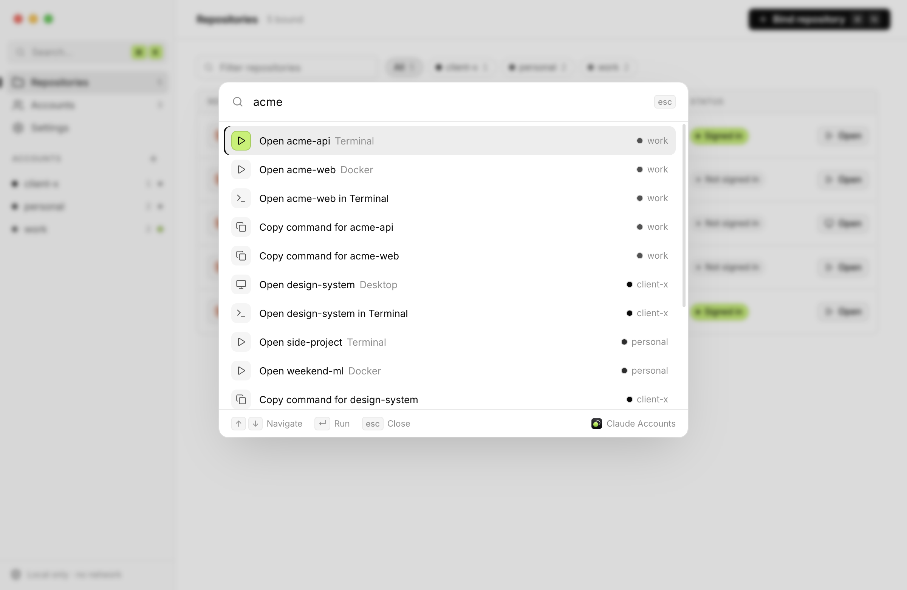
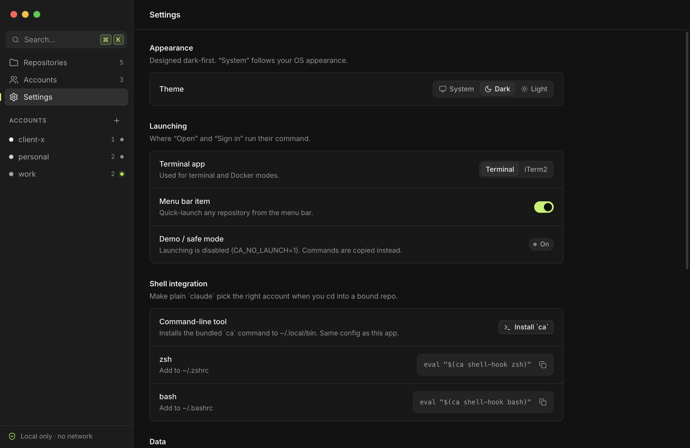
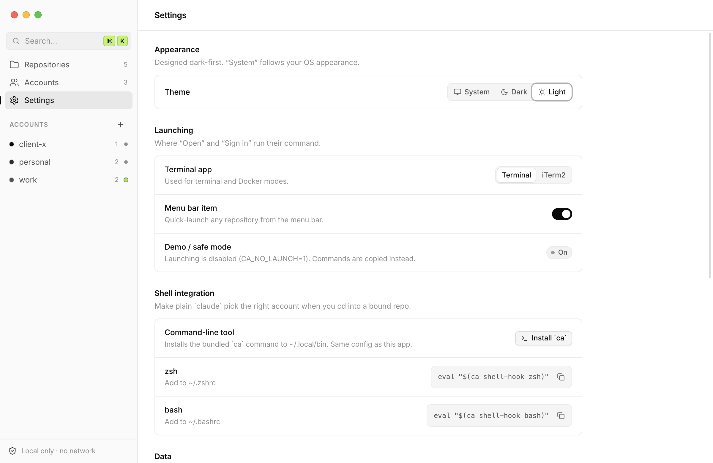
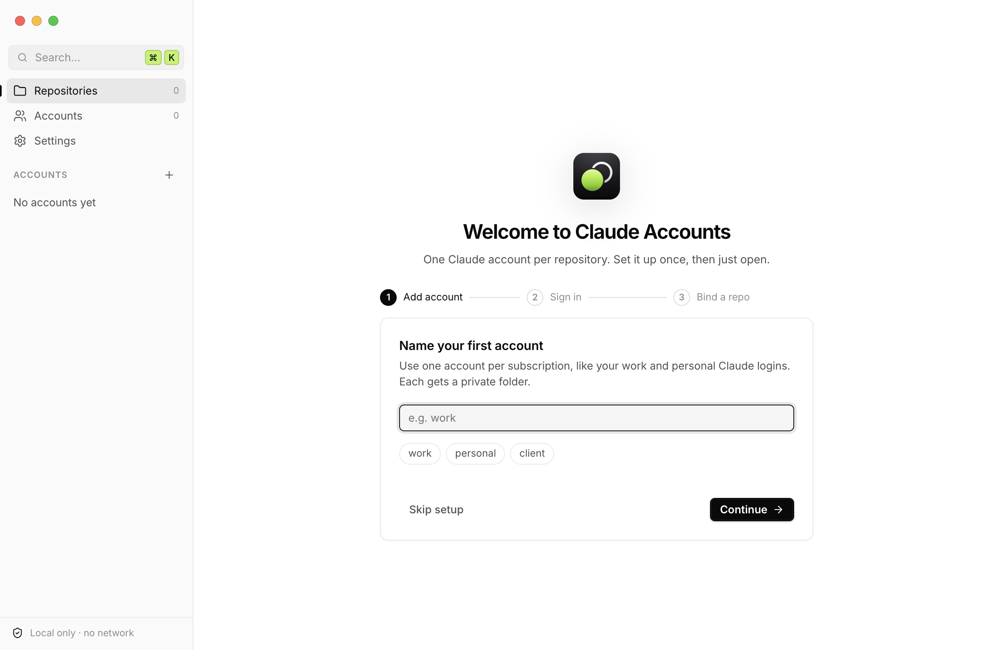

<p align="center">
  
</p>

<h1 align="center">Claude Accounts</h1>

<p align="center">
  <strong>Bind each repository to its own Claude Code account.</strong><br>
  Work repos use your work login, side projects use your personal one. No more logging out and back in.
</p>

<p align="center">
  <a href="https://github.com/gabrielmouallem/claude-accounts/actions/workflows/build.yml"></a>
  <a href="LICENSE"></a>
  
  
</p>

<p align="center">
  <picture>
    <source media="(prefers-color-scheme: light)" srcset="docs/screenshots/8-repositories-light.png">
    
  </picture>
</p>

---

## Why

Claude Code and Claude Desktop keep one login per user profile. There's no built-in way to say
"this repo uses my work account, that one uses my personal account"
([anthropics/claude-code#18435](https://github.com/anthropics/claude-code/issues/18435)).
Switching by hand is tedious and easy to get wrong: one forgotten `/logout` and your side project
runs on the company plan, or the other way round.

Claude Accounts gives every account its own isolated config directory and launches each session with
the right one for the folder you're in. It ships as two things that share one config file:

- **A desktop app** (Electron, macOS and Windows) with a repository list, per-account login status, a
  command palette and a menu-bar item.
- **`ca`**, a CLI with no dependencies that comes with the app, plus shell hooks so that plain `claude`
  picks the right account when you `cd` into a bound repo.

> [!WARNING]
> **Windows isn't ready.** macOS is the supported platform. The Windows build and its code are in the
> repository, but they haven't been run on a real Windows machine, and the bundled `ca` command doesn't run
> on Windows yet. Use it there only to try it out, and expect rough edges. Linux runs from source (below).

### Stay on your subscription

The goal is to get the most out of the Claude plans you already pay for (Pro, Max 5x, Max 20x,
Team) and keep sessions off API keys and usage credits:

- Every launch removes `ANTHROPIC_API_KEY` from the environment, so a key left in your shell can't
  quietly move a session to per-token billing.
- Each account signs in once with its own subscription and stays signed in.
- Claude Desktop is a first-class way to open a repository, next to the terminal: each account gets
  its own Desktop instance with its own `--user-data-dir`.

Claude Accounts picks an account by *where* you work, never by how much of a plan is left. It doesn't
rotate accounts to get around usage limits. Use each account as its plan's terms allow.

## How it works

You bind a folder to an account once. Subfolders inherit the binding. Every session started there
gets that account's login, settings and history, and nothing else.

```text
~/code/acme-api     ─▶  work      ─▶  CLAUDE_CONFIG_DIR=~/.config/claude-accounts/accounts/work/claude
~/code/side-project ─▶  personal  ─▶  CLAUDE_CONFIG_DIR=~/.config/claude-accounts/accounts/personal/claude
```

Each binding also picks **how** the session opens:

| Mode | What it launches | Where that account's login lives | Needs |
| --- | --- | --- | --- |
| **Terminal** | The official `claude` CLI in a new Terminal / iTerm window (macOS), `cmd` (Windows) or your terminal emulator (Linux) | `accounts/<name>/claude` via `CLAUDE_CONFIG_DIR` (on macOS the token itself is kept in the Keychain) | `claude` on your login-shell `PATH` |
| **Docker** | `claude` in a `node:24-slim` container, with the repo mounted at `/workspace` | `accounts/<name>/docker-claude`, mounted at `/home/node/.claude`. Run `/login` once inside. | Docker or Apple `container` |
| **Desktop** | A separate Claude Desktop instance with its own `--user-data-dir` | `accounts/<name>/desktop` | Claude Desktop (macOS / Windows) |

Containers keep a login of their own because, on macOS, the host token lives in the Keychain and a
Linux container can't read it.

Everything lives in one place:

```text
~/.config/claude-accounts/          # or the folder of $CA_CONFIG
├── config.json                     # accounts and repo bindings (paths only, no secrets)
├── docker/Dockerfile               # written on first Docker run, image claude-code-ca:latest
└── accounts/
    └── work/
        ├── claude/                 # CLAUDE_CONFIG_DIR for the CLI: login, settings, history
        ├── desktop/                # Claude Desktop --user-data-dir
        └── docker-claude/          # container login
```

### Dock apps (macOS)

Every account's Claude Desktop is the same Claude app, with the same name and icon, so the Dock can't tell them apart.
**Keep in Dock** gives an account a small app of its own: "*account* (Claude)" in `~/Applications/Claude Accounts`,
with the account's name on its icon. A click on it does this:

```text
click "work (Claude)"
  ─▶ is a Claude Desktop with --user-data-dir=…/accounts/work/desktop running?
       yes  ─▶  bring it forward
       no   ─▶  open a new Claude Desktop with --user-data-dir=…/accounts/work/desktop
                                          and  CLAUDE_CONFIG_DIR=…/accounts/work/claude
```

- **Built on your Mac.** Claude Accounts ships one small program, `launcher/launcher.swift`, and builds each Dock app
  around it. The app's `Info.plist` holds the account's name and folders, paths only. The same program draws the icon:
  Claude's mark over the account's name in capitals, or over the first word of a long name (`grade-account` shows
  GRADE). On a small Dock, the name gives way to its initial. Each app is signed ad hoc and registered with macOS, so
  Spotlight finds it too.
- **On a click,** it reads `config.json` first. It follows an account renamed with `ca`, and if the account is gone,
  it offers to take itself out of the Dock and move itself to the Trash. It finds the account's Claude by the
  `--user-data-dir` on its command line, never by its environment. Before it opens a new Claude, it drops
  `ANTHROPIC_API_KEY`, so that Claude runs on the account's plan. Before an account's first sign-in, it shows how to
  sign in to that window.
- **While its Claude is open,** the Dock app stays open too, so the Dock shows it running, and it quits when that
  Claude quits. **Quit** in its Dock menu quits that Claude the way Claude's own menu does, and switching to it with
  ⌘Tab switches to its Claude. Claude keeps running after you close its last window. If it comes forward with no
  window on screen, the Dock app sends it the reopen event that a click on Claude's own Dock icon sends. macOS asks
  you once whether it may (see [Troubleshooting](#troubleshooting)).
- **Claude Accounts opens Desktop through it.** For an account with a Dock app, opening a repository that opens with
  Claude Desktop brings that account's Claude forward instead of starting a second one.
- **Kept in step with your accounts.** Renaming an account rebuilds its Dock app under the new name, in the same place
  in the Dock. Removing the account, or **Remove from Dock**, takes the tile out and deletes the app. Changes made
  with `ca` count too: Claude Accounts watches `config.json`, and checks again when it starts. An update that changes
  the program rebuilds every Dock app.
- **Only its own tiles.** The Dock keeps its apps in its preferences (`com.apple.dock`, `persistent-apps`) and reads
  them when it starts. Claude Accounts adds, moves and removes only the tiles whose ids start with
  `dev.gabriel.claude-accounts.launcher.`, then restarts the Dock, which redraws for a moment. It does that only when
  a tile was added, moved or removed, or an icon changed. If your organization manages the Dock with a profile,
  nothing is changed.

Claude itself still shows as Claude in the Dock and in ⌘Tab, since only Claude can change its own name and icon. The
account's tile, with its running dot, tells you which accounts are open.

## Install the app

1. Download the build for your machine from [Releases](https://github.com/gabrielmouallem/claude-accounts/releases):
   - **macOS:** `ClaudeAccounts-<version>-mac-arm64` (Apple Silicon) or `-mac-x64` (Intel), as `.dmg` or `.zip`.
     Drag **Claude Accounts.app** to `/Applications`.
   - **Windows (not ready, see above):** `ClaudeAccounts-<version>-win-x64-portable.exe`, or the `.zip`.
2. The builds are **not signed or notarized** yet.
   - On macOS, the first launch is blocked. Right-click the app, choose **Open**, then **Open** again, or run:
     ```sh
     xattr -dr com.apple.quarantine "/Applications/Claude Accounts.app"
     ```
   - On Windows, SmartScreen may warn you. Choose **More info → Run anyway**.
3. The first time you open a session on macOS, the system asks whether the app may control Terminal or iTerm. Allow it.

**Requirements:** the [`claude` CLI](https://docs.anthropic.com/en/docs/claude-code) on your login-shell
`PATH`. Docker / Apple `container` only for Docker mode, Claude Desktop only for Desktop mode.

**Linux:** there's no packaged build yet. Run it from source (below). Terminal and Docker modes work.
There's no tray, and there's no official Claude Desktop for Linux.

## Using the app

<p align="center">
  
  
</p>

1. **Add an account.** Give it a short name like `work` or `personal`. It gets its own private folders.
2. **Sign in.** The app opens a terminal running `claude auth login` with that account's config dir.
   Finish the sign-in in your browser.
3. **Bind a repository.** Pick a folder, an account and a mode. From then on, press **Open**.

Other things you can do:

- Change a repo's account or mode inline in the list.
- From the row menu: open in a new `claude --worktree`, force Terminal, run in Docker or Apple `container`,
  copy the exact command, copy a direnv line, reveal the folder, or unbind.
- **Accounts** shows who each account is signed in as (email and plan), its CLI and container sign-in, and its
  repositories. The status updates by itself, including right after a sign-in. **Refresh** (⌘R) asks again.
- Rename an account from its **⋯** menu or the palette. Its repositories move with it, and it stays signed in.
- **Keep an account in the Dock** (macOS), from its card, its **⋯** menu or the palette. It gets an app of its own,
  "*account* (Claude)" in `~/Applications/Claude Accounts`, whose icon shows the account's name under Claude's mark.
  Click it to open that account's Claude Desktop, or to bring it forward. The Dock shows it running while that Claude
  is open, and **Quit** in its Dock menu quits that Claude. Renaming or removing the account updates or removes it.
  See [Dock apps](#dock-apps-macos) for how they work.
- Remove an account from its **⋯** menu. **Sign out and move its folders to the Trash** is on by default: it signs
  the account out of Claude Code, then moves its folders (its Claude Code settings and history, and its Claude Desktop
  data) to the Trash. Turn it off to keep them where they are.
- **Settings**: theme, Terminal vs iTerm2, the menu-bar item, and a one-click install of the `ca` CLI to `~/.local/bin`.
- The app watches `config.json`, so changes made with the CLI show up live.

<details>
<summary><strong>Keyboard shortcuts</strong></summary>

<br>

On Windows and Linux, use <kbd>Ctrl</kbd> in place of <kbd>⌘</kbd>.

| Shortcut | Action |
| --- | --- |
| <kbd>⌘</kbd> <kbd>K</kbd> | Command palette (open any repo, sign in, check status, switch theme…) |
| <kbd>⌘</kbd> <kbd>N</kbd> | Bind repository |
| <kbd>⇧</kbd> <kbd>⌘</kbd> <kbd>N</kbd> | Add account |
| <kbd>⌘</kbd> <kbd>1</kbd> / <kbd>2</kbd> / <kbd>3</kbd> | Repositories / Accounts / Settings |
| <kbd>⌘</kbd> <kbd>,</kbd> | Settings |
| <kbd>⌘</kbd> <kbd>R</kbd> | Refresh login status |
| <kbd>/</kbd> | Filter repositories |
| <kbd>↑</kbd> <kbd>↓</kbd> or <kbd>j</kbd> <kbd>k</kbd> | Move through the list |
| <kbd>↵</kbd> | Open the selected repository |
| <kbd>⇧</kbd> <kbd>⌘</kbd> <kbd>C</kbd> | Copy the selected repository's command |
| <kbd>Esc</kbd> | Close menu, dialog or palette |

</details>

<details>
<summary><strong>More screenshots</strong> (repositories, command palette, settings, first run), dark and light</summary>

<br>

<p align="center">
  
  
  
  
  
  
  
  
</p>

</details>

## The `ca` CLI

`ca` reads and writes the same `config.json` as the app, so you can mix them freely.

**Install** from the app with *Settings → Install `ca`*. It puts the `ca` that comes with the app, a single
executable, in `~/.local/lib/claude-accounts`, and a small script that starts it in `~/.local/bin/ca`.

Without the app, use the Python version, [`cli/ca`](cli/ca): one stdlib-only Python 3 file. It is older and has no
`rename-account`.

```sh
mkdir -p ~/.local/bin && curl -fsSL https://raw.githubusercontent.com/gabrielmouallem/claude-accounts/main/cli/ca -o ~/.local/bin/ca && chmod +x ~/.local/bin/ca
```

**Quick start:**

```sh
ca add-account work                 # creates ~/.config/claude-accounts/accounts/work/{claude,desktop,docker-claude}
ca add-account personal
ca login work                       # runs `claude auth login` with work's config dir (browser sign-in)
ca login personal

ca bind ~/code/acme work
ca bind ~/code/side personal --mode docker

cd ~/code/acme/packages/api && ca run   # finds the nearest bound parent, starts claude as "work"
```

<details>
<summary><strong>All commands</strong></summary>

```sh
ca add-account <name> [--config-dir D] [--desktop-dir D] [--docker-dir D]
ca rename-account <name> <new-name> # its repositories move with it; its folders and sign-in stay
ca bind <repo> <account> [--mode terminal|docker|desktop]
ca unbind <repo>
ca list
ca status [--deep]                  # --deep asks `claude auth status` who each account is signed in as
ca run [repo] [-w [name]] [--print] [-- extra claude args]
                                    # -w passes --worktree; --print shows the command instead of running it
ca login <account> [--print]
ca desktop <account> [--launch] [--os Darwin|Windows|Linux]
ca docker-run [repo] [--engine docker|container] [--build] [--print]
ca env [path] [--shell]             # what CLAUDE_CONFIG_DIR a path resolves to
ca shell-hook zsh|bash|direnv [repo] [--write]
```

Set `CA_CONFIG=/path/to/config.json` to use a different config file.

</details>

### Make plain `claude` pick the right account

Add a hook and `CLAUDE_CONFIG_DIR` follows you as you `cd`. If you set `CLAUDE_CONFIG_DIR` yourself,
the hook puts your value back when you leave a bound repository.

```sh
# zsh: add to ~/.zshrc (uses a chpwd hook)
eval "$(ca shell-hook zsh)"

# bash: add to ~/.bashrc (uses PROMPT_COMMAND)
eval "$(ca shell-hook bash)"

# direnv: adds the line to one repo's .envrc, then says how to allow it
ca shell-hook direnv ~/code/acme --write
```

## Security and privacy

- **Credential contents are never read.** Sign-in status comes from whether
  `<config_dir>/.credentials.json` exists and from the official `claude auth status`, which reports the
  account's email and plan, never its token. On macOS the token lives in the Keychain, so the app asks
  `claude auth status` about every account with files in its folder: once when it starts, once when an
  account's folder first gets files while it runs (after `ca login`, say), again when you press **Refresh**,
  and while it waits for a sign-in it opened.
- **No network, no telemetry.** The app cancels every request that isn't to its own bundled files,
  loads no remote content, and ships its own fonts and icons. The `claude` processes it launches
  talk to Anthropic as usual. The status check runs with Claude Code's analytics, error reports and
  update checks turned off, though like any `claude` command it may renew a sign-in that has expired.
  The `ca` command the app installs starts with `DO_NOT_TRACK=1`, which turns off the crash reports
  of the Bun runtime inside it.
- **`ANTHROPIC_API_KEY` is stripped** from every session it launches, in any letter case, so the
  account's subscription login is used instead of a global key.
- **Private folders.** Account folders are created `0700`. The app writes `config.json` atomically
  with mode `0600`. The file holds paths and bindings only, never credentials. The app removes folders only when
  you remove an account with **Sign out and move its folders to the Trash** on, and then moves only that account's
  own folders, inside `~/.config/claude-accounts/accounts`, to the Trash.
- **Dock apps** find their account's Claude by its command line, never its environment, and change only their own
  tiles in the Dock.
- **Electron hardening.** `contextIsolation`, no `nodeIntegration`, a sandboxed renderer, a minimal
  preload, a strict CSP, sender checks and validation on every IPC call. Navigation, new windows and
  permission requests are denied.
- **No shell strings from your data.** Folder and account names reach processes as arguments, the
  working directory or environment variables, never pasted into a command line. On Windows that keeps
  a folder named `R&D` from being read as two commands. A folder name with a control character in it
  is refused rather than typed into a terminal.
- **Programs come from your `PATH`, never from the repository.** Windows looks for a program in the
  current folder first, so a repository could carry its own `cmd.exe`, `claude.cmd`, or a `node.cmd`
  for npm's `claude.cmd` to pick up. The app starts `cmd` by its full path, outside the repository,
  and stops it from searching the repository; the CLI only looks in `PATH` and does the same.
- **The CLI opens no ports** and, like the app, writes `config.json` with mode `0600`.

Found a security issue? Please open a [private security advisory](https://github.com/gabrielmouallem/claude-accounts/security/advisories/new)
instead of a public issue.

## Troubleshooting

<details>
<summary><strong>The badge says <code>Unconfirmed</code></strong></summary>

The account's folder has files, but `claude auth status` didn't confirm a sign-in. Hover the badge to see why.
Usually `claude` isn't on your login shell's `PATH` (see below). Click **Refresh** on Accounts, or run
`ca status --deep`, to ask again.
</details>

<details>
<summary><strong>Claude Desktop keeps asking me to sign in</strong></summary>

Each account opens its own Claude Desktop window, with its own data folder, so each one signs in once and then stays
signed in. A sign-in that finishes in your browser (**Continue with Google**, or the link in the sign-in email) comes
back to Claude Desktop as a `claude://` link, and macOS hands that link to the Claude that was open first, not to the
new window. That Claude ignores a Google sign-in it didn't start, and the email's link can sign it in instead.

So sign in inside the account's window with **Continue with email** and type the code from the email there. Or quit
your other Claude windows before you sign in with Google. The account's **⋯** menu has **Sign in to Claude Desktop…**
with these steps, and the app shows them the first time you open an account's window.
</details>

<details>
<summary><strong><code>claude: command not found</code> when opening a session</strong></summary>

Apps launched from Finder get a minimal `PATH`. Claude Accounts asks your login shell (`$SHELL -ilc`)
for its `PATH` and adds `~/.local/bin`, `~/.claude/local`, `/opt/homebrew/bin` and `/usr/local/bin`.
If `claude` lives somewhere else, make sure your login shell's `PATH` includes it.
</details>

<details>
<summary><strong>Windows: a copied command fails in PowerShell</strong></summary>

The Windows commands the app copies, and `ca` prints, are for Command Prompt (`cmd`). They start with `@`
so that PowerShell rejects the whole line instead of running part of it on the wrong account. Paste
them into Command Prompt, or open the repository from the app.
</details>

<details>
<summary><strong>Windows: a program in the repository isn't found by its name</strong></summary>

Sessions opened from Claude Accounts set `NoDefaultCurrentDirectoryInExePath`, so `cmd` doesn't run a
program from the current folder by name. Without it, a repository could hand npm's `claude.cmd` its
own `node`. Run such a program by its path instead, for example `.\gradlew` rather than `gradlew`.
</details>

<details>
<summary><strong>Removing an account didn't log it out</strong></summary>

Remove it with **Sign out and move its folders to the Trash** on, which is the default. That runs `claude auth logout`
for the account first, which deletes its sign-in from the Keychain, and then moves its folders to the Trash. Deleting the folder by hand
leaves that sign-in in the Keychain, filed under the folder's path, so an account added later with the same name finds
itself signed in. If that happened, add the account again, then remove it with the option on.
</details>

<details>
<summary><strong>macOS asks whether "<em>account</em> (Claude)" may control Claude</strong></summary>

It asks once, the first time you click an account's Dock app while that account's Claude is open without a window.
Allowing it lets the app bring the window back, the way clicking Claude in the Dock does. Without it, quit that
Claude from the app's Dock menu and click again. You can change your answer in System Settings, under Privacy &
Security, then Automation.
</details>

<details>
<summary><strong>The Dock shows an old icon</strong></summary>

The Dock keeps its own cache of icons, and restarting the Dock doesn't clear it, so after an update a tile can keep
its old picture. Clear the cache, then restart the Dock and Finder:

```sh
rm "$(getconf DARWIN_USER_CACHE_DIR)com.apple.dock.iconcache"
killall -KILL Dock; killall Finder
```

The Dock writes a new cache as it starts.
</details>

<details>
<summary><strong>Docker mode asks me to log in again</strong></summary>

That's expected the first time. Containers can't read the macOS Keychain, so each account has a
separate container login in `accounts/<name>/docker-claude`. Type `/login` inside the container once.
</details>

## Project status

Version 1.0. The core logic is covered by tests; real-world use on every platform is not yet.

- **Verified:** 43 `node:test` tests (plus 8 that run only on Windows) and 22 `unittest` tests pass
  on macOS (Apple Silicon) and Linux, and CI runs them on Linux, macOS and Windows. They cover config
  handling and validation, lookup from subdirectories, environment construction, a real
  `claude --version` under a per-account `CLAUDE_CONFIG_DIR`, `claude auth status` isolation between
  accounts, the existence-only credential check, Docker / `container` / Desktop command generation,
  the shell hooks (including putting back your own `CLAUDE_CONFIG_DIR`), IPC input validation, and
  config compatibility between the app and the CLI. The app and the CLI are checked to print the same
  commands and to accept the same account names. On Windows, the tests run the real `cmd.exe` from a
  folder named with `cmd` syntax and check that nothing in the name runs, and that a `cmd.exe`,
  `claude.cmd` or `node.cmd` planted in the repository never does. The UI was exercised and
  screenshotted under Xvfb. The macOS bundle structure was inspected (Info.plist, icon, arm64/x64 Mach-O).
  The packaged app was run on a real Mac (Apple Silicon): two accounts signed in for real and each showed
  its own email, and opening a sign-in started one Terminal window whether Terminal was open or not.
- **Not yet verified:** anything on a real Windows machine, the tray and vibrancy, and Claude Desktop
  multi-instance (`--user-data-dir`, `open --env`). Docker and Apple `container` commands are generated and
  unit-tested, but no image was built or run.

Bug reports from real macOS setups are very welcome.

## Roadmap

- **Rules by git remote or folder.** Bind `github.com/acme/*` once and every repository cloned from
  that organization uses the right account, including ones you clone later. A single repository can
  still override its rule.
- **Sign-in apart from settings.** Keep one sign-in per account while sharing `CLAUDE.md`, skills and
  MCP servers across accounts, with per-account overrides.
- **Claude Desktop first.** Open repositories in Claude Desktop by default, with Terminal and Docker
  as alternatives.
- **A redesign** on a small design system: a neutral, native-feeling window, one shaded color per
  account, light and dark themes, and a keyboard path for everything.
- **A TypeScript core** shared by the app and the CLI, so the two can't drift apart.

## Development

Requires Node.js 24+, which runs the TypeScript tests and scripts as they are, and `python3` (for the Python CLI and
its tests). `npm ci` installs Bun, which compiles the CLI.

```sh
git clone https://github.com/gabrielmouallem/claude-accounts.git
cd claude-accounts
npm install
npm start            # build, then run the app (with your real config)
npm run typecheck    # tsc
npm test             # node:test suite
python3 -m unittest discover -s cli -p 'test_*.py' -v   # CLI tests (throwaway config, no network, no login)
```

| Script | What it does |
| --- | --- |
| `npm run build` | Bundle `src/` into `out/` with esbuild. `start`, `sandbox`, `shots` and the `dist` scripts run it first |
| `npm run typecheck` | Check the types of the app, the UI, the tests and the scripts with `tsc` |
| `npm run dist:mac` | Unsigned macOS build, arm64 + x64, `.dmg` + `.zip` (`.dmg` needs macOS) |
| `npm run dist:win` | Unsigned Windows build, portable `.exe` + `.zip` |
| `npm run dist` | Both of the above |
| `npm run icons` | Draw the icon from `scripts/icon-art.ts` into `build/` (`.svg`, `.png`, `.icns`, `.ico`) and the in-app mark |
| `npm run sandbox` | Run the app on fake demo accounts in a throwaway home, launching disabled (`-- --empty` for the first run) |
| `npm run shots` | Regenerate `docs/screenshots` from fake demo data (macOS, or Linux under Xvfb) |

Set `CA_NO_LAUNCH=1` to run the app in a safe demo mode that copies commands instead of launching anything.
`npm run sandbox` sets it for you.

**Layout**

```text
src/main.ts         Electron main process: IPC, launching, tray, menus, config watcher
src/core.ts         Config handling and command generation (a port of the CLI's logic)
src/validate.ts     A schema for every IPC payload (zod)
src/types.ts        Types shared by the main process, the preload and the UI, IPC channels included
src/preload.ts      The small API exposed to the renderer
src/renderer/       The UI: TypeScript, no framework, bundled Inter font and icons
cli/ca.ts           The CLI the app bundles, compiled with Bun (scripts/build-cli.ts); it shares src/core.ts
cli/ca              The older Python CLI, for use without the app; tests keep it in step with src/core.ts
test/               node:test suite (core logic + CLI compatibility)
scripts/            The build (esbuild), icon art and generation, the sandbox launcher, screenshots, demo config
out/                The build Electron runs and packages (git-ignored)
AGENTS.md           Map and rules for contributors and coding agents (CLAUDE.md imports it)
.claude/            Area rules, skills (/run-app, /release) and a security reviewer for Claude Code
```

**CI and releases.** [`.github/workflows/build.yml`](.github/workflows/build.yml) runs the type check, the
build and both test suites, and builds unsigned macOS and Windows artifacts. Pushing a `v*` tag attaches them to a GitHub Release,
using only the built-in `GITHUB_TOKEN`.

**Signing and notarization (optional).** Remove `"identity": null` from `build.mac`, add
`"hardenedRuntime": true` and `"notarize": true`, and provide `CSC_LINK` / `CSC_KEY_PASSWORD`
(Developer ID certificate) and `APPLE_ID` / `APPLE_APP_SPECIFIC_PASSWORD` / `APPLE_TEAM_ID`.

## Contributing

Issues and pull requests are welcome. For bugs, please include your OS, the app or CLI version, and
`claude --version`. For larger changes, open an issue first so we can agree on the approach.

Before sending a PR, run `npm run typecheck`, `npm test` and the CLI tests. A change to `cli/ca` or `src/core.ts` usually
needs the same change in the other; the parity tests say where they differ. To try a change, run
`npm run sandbox`: the app opens on fake demo accounts and leaves your real config alone.
Never include real config files, credentials or email addresses in an issue or PR.

[AGENTS.md](AGENTS.md) holds the project map and the rules that never bend (credentials, network,
shell strings, IPC). Coding agents read it, and it's a quick read for people too. Claude Code also
loads the area rules in `.claude/rules/` and has `/run-app` to drive the app in that sandbox.

## Terms of use

You're responsible for using this tool in line with Anthropic's terms. Use it only with accounts that
are yours, not to share credentials or subscriptions.

## Disclaimer

This is an independent project. It is **not affiliated with, endorsed by, or sponsored by Anthropic**.
"Claude", "Claude Code" and the Claude logo are trademarks of Anthropic, PBC.

## License

[MIT](LICENSE) © 2026 Gabriel Mouallem
