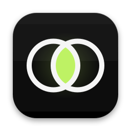
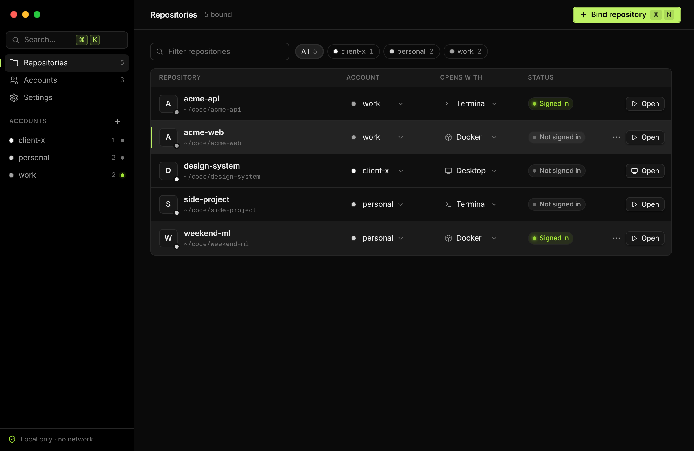
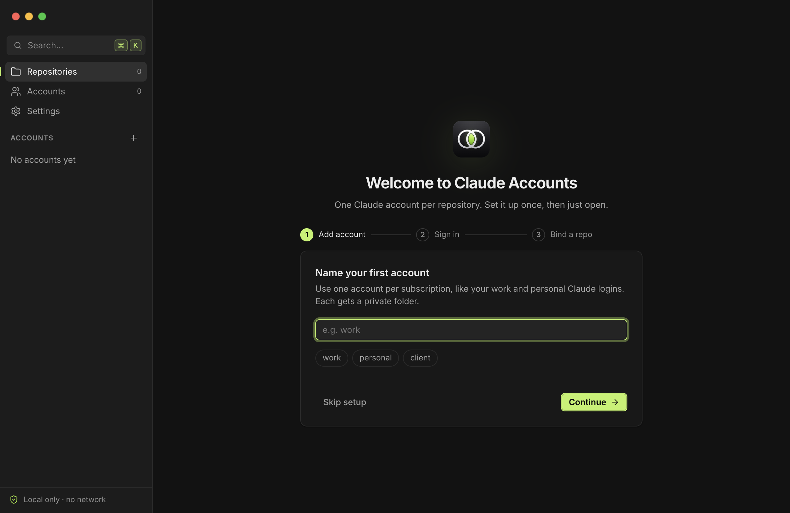
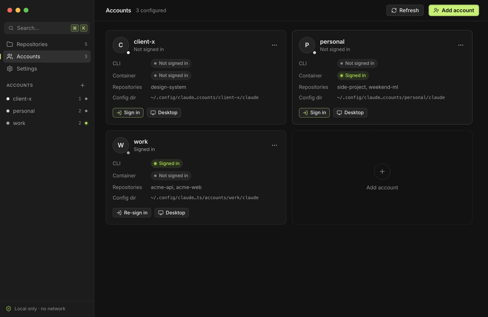
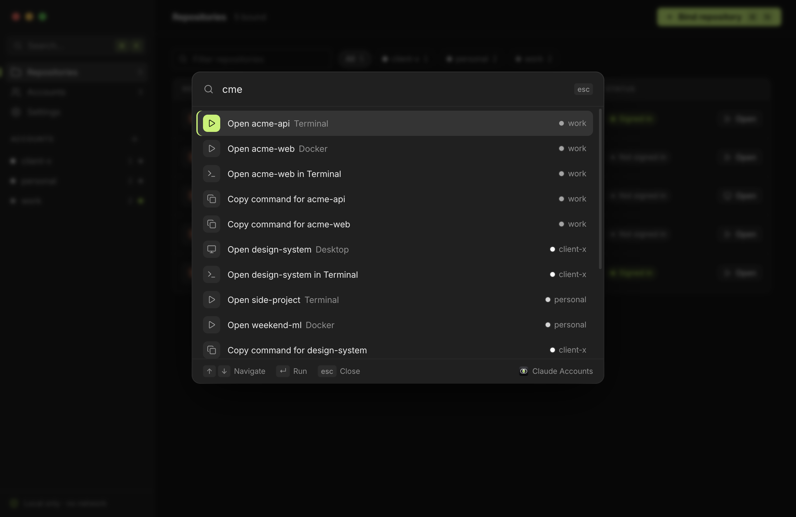
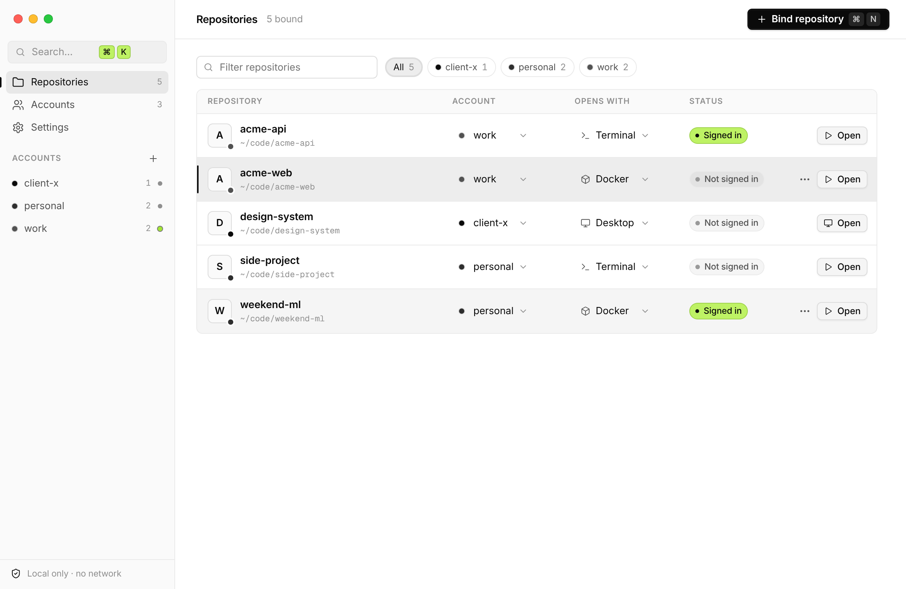
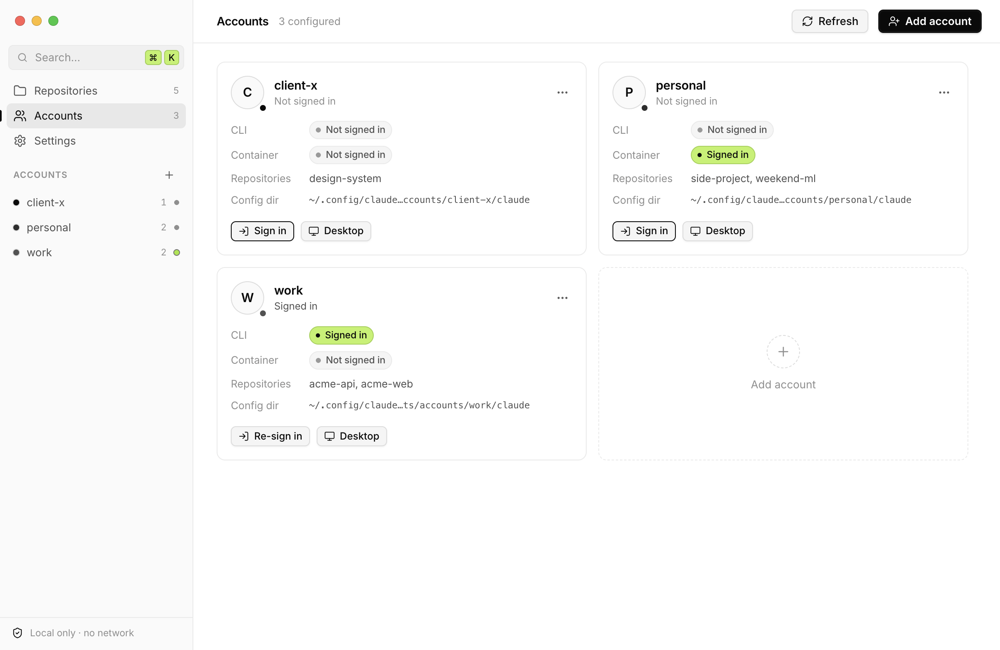

<p align="center">
  
</p>

<h1 align="center">Claude Accounts</h1>

<p align="center">
  <strong>Bind each repository to its own Claude Code account.</strong><br>
  Work repos use your work login, side projects use your personal one. No more logging out and back in.
</p>

<p align="center">
  <a href="https://github.com/gabrielmouallem/claude-accounts/actions/workflows/build.yml"></a>
  <a href="LICENSE"></a>
  
  
</p>

<p align="center">
  
</p>

---

## Why

Claude Code and Claude Desktop keep one login per user profile. There's no built-in way to say
"this repo uses my work account, that one uses my personal account"
([anthropics/claude-code#18435](https://github.com/anthropics/claude-code/issues/18435)).
Switching by hand is tedious and easy to get wrong: one forgotten `/logout` and your side project
runs on the company plan, or the other way round.

Claude Accounts gives every account its own isolated config directory and launches each session with
the right one for the folder you're in. It ships as two things that share one config file:

- **A desktop app** (Electron, macOS and Windows) with a repository list, per-account login status, a
  command palette and a menu-bar item.
- **`ca`**, a single-file Python CLI with no dependencies, plus shell hooks so that plain `claude`
  picks the right account when you `cd` into a bound repo.

## How it works

You bind a folder to an account once. Subfolders inherit the binding. Every session started there
gets that account's login, settings and history, and nothing else.

```text
~/code/acme-api     ─▶  work      ─▶  CLAUDE_CONFIG_DIR=~/.config/claude-accounts/accounts/work/claude
~/code/side-project ─▶  personal  ─▶  CLAUDE_CONFIG_DIR=~/.config/claude-accounts/accounts/personal/claude
```

Each binding also picks **how** the session opens:

| Mode | What it launches | Where that account's login lives | Needs |
| --- | --- | --- | --- |
| **Terminal** | The official `claude` CLI in a new Terminal / iTerm window (macOS), `cmd` (Windows) or your terminal emulator (Linux) | `accounts/<name>/claude` via `CLAUDE_CONFIG_DIR` (on macOS the token itself is kept in the Keychain) | `claude` on your login-shell `PATH` |
| **Docker** | `claude` in a `node:20-slim` container, with the repo mounted at `/workspace` | `accounts/<name>/docker-claude`, mounted at `/home/node/.claude`. Run `/login` once inside. | Docker or Apple `container` |
| **Desktop** | A separate Claude Desktop instance with its own `--user-data-dir` | `accounts/<name>/desktop` | Claude Desktop (macOS / Windows) |

Containers keep a login of their own because, on macOS, the host token lives in the Keychain and a
Linux container can't read it.

Everything lives in one place:

```text
~/.config/claude-accounts/          # or the folder of $CA_CONFIG
├── config.json                     # accounts and repo bindings (paths only, no secrets)
├── docker/Dockerfile               # written on first Docker run, image claude-code-ca:latest
└── accounts/
    └── work/
        ├── claude/                 # CLAUDE_CONFIG_DIR for the CLI: login, settings, history
        ├── desktop/                # Claude Desktop --user-data-dir
        └── docker-claude/          # container login
```

## Install the app

1. Download the build for your machine from [Releases](https://github.com/gabrielmouallem/claude-accounts/releases):
   - **macOS:** `ClaudeAccounts-<version>-mac-arm64` (Apple Silicon) or `-mac-x64` (Intel), as `.dmg` or `.zip`.
     Drag **Claude Accounts.app** to `/Applications`.
   - **Windows:** `ClaudeAccounts-<version>-win-x64-portable.exe`, or the `.zip`.
2. The builds are **not signed or notarized** yet.
   - On macOS, the first launch is blocked. Right-click the app, choose **Open**, then **Open** again, or run:
     ```sh
     xattr -dr com.apple.quarantine "/Applications/Claude Accounts.app"
     ```
   - On Windows, SmartScreen may warn you. Choose **More info → Run anyway**.
3. The first time you open a session on macOS, the system asks whether the app may control Terminal or iTerm. Allow it.

**Requirements:** the [`claude` CLI](https://docs.anthropic.com/en/docs/claude-code) on your login-shell
`PATH`. Docker / Apple `container` only for Docker mode, Claude Desktop only for Desktop mode.

**Linux:** there's no packaged build yet. Run it from source (below). Terminal and Docker modes work.
There's no tray, and there's no official Claude Desktop for Linux.

## Using the app

<p align="center">
  
  
</p>

1. **Add an account.** Give it a short name like `work` or `personal`. It gets its own private folders.
2. **Sign in.** The app opens a terminal running `claude auth login` with that account's config dir.
   Finish the sign-in in your browser.
3. **Bind a repository.** Pick a folder, an account and a mode. From then on, press **Open**.

Other things you can do:

- Change a repo's account or mode inline in the list.
- From the row menu: open in a new `claude --worktree`, force Terminal, run in Docker or Apple `container`,
  copy the exact command, copy a direnv line, reveal the folder, or unbind.
- **Accounts** shows CLI and container login badges. **Check status** runs `claude auth status` for a definitive answer.
- **Settings**: theme, Terminal vs iTerm2, the menu-bar item, and a one-click install of the `ca` CLI to `~/.local/bin`.
- The app watches `config.json`, so changes made with the CLI show up live.

<details>
<summary><strong>Keyboard shortcuts</strong></summary>

<br>

On Windows and Linux, use <kbd>Ctrl</kbd> in place of <kbd>⌘</kbd>.

| Shortcut | Action |
| --- | --- |
| <kbd>⌘</kbd> <kbd>K</kbd> | Command palette (open any repo, sign in, check status, switch theme…) |
| <kbd>⌘</kbd> <kbd>N</kbd> | Bind repository |
| <kbd>⇧</kbd> <kbd>⌘</kbd> <kbd>N</kbd> | Add account |
| <kbd>⌘</kbd> <kbd>1</kbd> / <kbd>2</kbd> / <kbd>3</kbd> | Repositories / Accounts / Settings |
| <kbd>⌘</kbd> <kbd>,</kbd> | Settings |
| <kbd>⌘</kbd> <kbd>R</kbd> | Refresh login status |
| <kbd>/</kbd> | Filter repositories |
| <kbd>↑</kbd> <kbd>↓</kbd> or <kbd>j</kbd> <kbd>k</kbd> | Move through the list |
| <kbd>↵</kbd> | Open the selected repository |
| <kbd>⇧</kbd> <kbd>⌘</kbd> <kbd>C</kbd> | Copy the selected repository's command |
| <kbd>Esc</kbd> | Close menu, dialog or palette |

</details>

<details>
<summary><strong>More screenshots</strong> (command palette, light theme)</summary>

<br>

<p align="center">
  
  
  
</p>

</details>

## The `ca` CLI

`ca` is one stdlib-only Python 3 script ([`cli/ca`](cli/ca)). It reads and writes the same
`config.json` as the app, so you can mix them freely.

**Install** (or use *Settings → Install `ca`* in the app):

```sh
mkdir -p ~/.local/bin && curl -fsSL https://raw.githubusercontent.com/gabrielmouallem/claude-accounts/main/cli/ca -o ~/.local/bin/ca && chmod +x ~/.local/bin/ca
```

**Quick start:**

```sh
ca add-account work                 # creates ~/.config/claude-accounts/accounts/work/{claude,desktop,docker-claude}
ca add-account personal
ca login work                       # runs `claude auth login` with work's config dir (browser sign-in)
ca login personal

ca bind ~/code/acme work
ca bind ~/code/side personal --mode docker

cd ~/code/acme/packages/api && ca run   # finds the nearest bound parent, starts claude as "work"
```

<details>
<summary><strong>All commands</strong></summary>

```sh
ca add-account <name> [--config-dir D] [--desktop-dir D] [--docker-dir D]
ca bind <repo> <account> [--mode terminal|docker|desktop]
ca unbind <repo>
ca list
ca status [--deep]                  # --deep asks `claude auth status` (prints status, never the token)
ca run [repo] [-w [name]] [--print] [-- extra claude args]
                                    # -w passes --worktree; --print shows the command instead of running it
ca login <account> [--print]
ca desktop <account> [--launch] [--os Darwin|Windows|Linux]
ca docker-run [repo] [--engine docker|container] [--build] [--print]
ca env [path] [--shell]             # what CLAUDE_CONFIG_DIR a path resolves to
ca shell-hook zsh|bash|direnv [repo] [--write]
ca ui [--port N] [--no-launch]      # small local web UI on 127.0.0.1 with a random per-run token
```

Set `CA_CONFIG=/path/to/config.json` to use a different config file.

</details>

### Make plain `claude` pick the right account

Add a hook and `CLAUDE_CONFIG_DIR` follows you as you `cd`:

```sh
# zsh: add to ~/.zshrc (uses a chpwd hook)
eval "$(ca shell-hook zsh)"

# bash: add to ~/.bashrc (uses PROMPT_COMMAND)
eval "$(ca shell-hook bash)"

# direnv: writes an .envrc for one repo
ca shell-hook direnv ~/code/acme --write && direnv allow ~/code/acme
```

## Security and privacy

- **Credential contents are never read.** Login badges only check whether
  `<config_dir>/.credentials.json` exists, or ask the official `claude auth status`. On macOS the CLI
  token lives in the Keychain, so the badge reads `Keychain?` until you run *Check status*.
- **No network, no telemetry.** The app cancels every request that isn't to its own bundled files,
  loads no remote content, and ships its own fonts and icons. The `claude` processes it launches
  talk to Anthropic as usual.
- **`ANTHROPIC_API_KEY` is stripped** from every session it launches, so the account's subscription
  login is used instead of a global key.
- **Private folders.** Account folders are created `0700`. The app writes `config.json` atomically
  with mode `0600`. The file holds paths and bindings only, never credentials.
- **Electron hardening.** `contextIsolation`, no `nodeIntegration`, a sandboxed renderer, a minimal
  preload, a strict CSP, sender checks and validation on every IPC call. Navigation, new windows and
  permission requests are denied.
- **`ca ui`** listens on `127.0.0.1` only, needs a random per-run token, checks the `Host` header
  against DNS rebinding, and doesn't log requests.

Found a security issue? Please open a [private security advisory](https://github.com/gabrielmouallem/claude-accounts/security/advisories/new)
instead of a public issue.

## Troubleshooting

<details>
<summary><strong>The badge says <code>Keychain?</code></strong></summary>

On macOS, Claude Code stores the login token in the Keychain, not in a file, so the app can't tell from
the folder alone. Click **Check status** on the account (or run `ca status --deep`). It runs
`claude auth status` with that account's config dir.
</details>

<details>
<summary><strong><code>claude: command not found</code> when opening a session</strong></summary>

Apps launched from Finder get a minimal `PATH`. Claude Accounts asks your login shell (`$SHELL -ilc`)
for its `PATH` and adds `~/.local/bin`, `~/.claude/local`, `/opt/homebrew/bin` and `/usr/local/bin`.
If `claude` lives somewhere else, make sure your login shell's `PATH` includes it.
</details>

<details>
<summary><strong>Removing an account didn't log it out</strong></summary>

Removing an account only takes it out of `config.json`. Its folders (login, history, Desktop data) are
kept on purpose. To wipe them, use *Reveal folder* on the account first, then delete the folder.
</details>

<details>
<summary><strong>Docker mode asks me to log in again</strong></summary>

That's expected the first time. Containers can't read the macOS Keychain, so each account has a
separate container login in `accounts/<name>/docker-claude`. Type `/login` inside the container once.
</details>

## Project status

Version 1.0. The core logic is covered by tests; real-world use on every platform is not yet.

- **Verified:** 13 `node:test` tests and 12 `unittest` tests pass on Linux and on macOS (Apple
  Silicon). They cover config handling and validation, lookup from subdirectories, environment
  construction, a real `claude --version` under a per-account `CLAUDE_CONFIG_DIR`, `claude auth status`
  isolation between accounts, the existence-only credential check, Docker / `container` / Desktop
  command generation, the shell hooks, the web UI token and `Host` checks, IPC input validation, and
  config compatibility between the app and the CLI. The UI was exercised and screenshotted under Xvfb.
  The macOS bundle structure was inspected (Info.plist, icon, arm64/x64 Mach-O).
- **Not yet verified:** the packaged app on real macOS and Windows, which covers the Keychain badge,
  vibrancy, the tray, AppleScript terminal launch, Claude Desktop multi-instance (`--user-data-dir`,
  `open --env`) and launching on Windows. Real sign-ins weren't tested either. Docker and Apple `container`
  commands are generated and unit-tested, but no image was built or run.

Bug reports from real macOS and Windows setups are very welcome.

## Development

Requires Node.js 22+ and `python3` (for the CLI and its tests).

```sh
git clone https://github.com/gabrielmouallem/claude-accounts.git
cd claude-accounts
npm install
npm start            # run the app
npm test             # node:test suite
python3 -m unittest discover -s cli -p 'test_*.py' -v   # CLI tests (throwaway config, no network, no login)
```

| Script | What it does |
| --- | --- |
| `npm run dist:mac` | Unsigned macOS build, arm64 + x64, `.dmg` + `.zip` (`.dmg` needs macOS) |
| `npm run dist:win` | Unsigned Windows build, portable `.exe` + `.zip` |
| `npm run dist` | Both of the above |
| `npm run icons` | Regenerate `build/icon.{png,icns,ico}` from `build/icon.svg` |
| `npm run shots` | Regenerate `docs/screenshots` from fake demo data (needs a display, e.g. Xvfb) |
| `npm run sync-ca` | Copy `cli/ca` into `resources/ca` (the copy bundled with the app) |

Set `CA_NO_LAUNCH=1` to run the app in a safe demo mode that copies commands instead of launching anything.

**Layout**

```text
src/main.js         Electron main process: IPC, launching, tray, menus, config watcher
src/core.js         Config handling and command generation (a port of the CLI's logic)
src/validate.js     Validation for every IPC payload
src/preload.js      The small API exposed to the renderer
src/renderer/       The UI: vanilla JS, no framework, bundled Inter font and icons
cli/ca              The Python CLI. Source of truth; CI checks resources/ca matches it.
test/               node:test suite (core logic + CLI compatibility)
scripts/            Icon generation, screenshots, demo config
```

**CI and releases.** [`.github/workflows/build.yml`](.github/workflows/build.yml) runs both test suites
and builds unsigned macOS and Windows artifacts. Pushing a `v*` tag attaches them to a GitHub Release,
using only the built-in `GITHUB_TOKEN`.

**Signing and notarization (optional).** Remove `"identity": null` from `build.mac`, add
`"hardenedRuntime": true` and `"notarize": true`, and provide `CSC_LINK` / `CSC_KEY_PASSWORD`
(Developer ID certificate) and `APPLE_ID` / `APPLE_APP_SPECIFIC_PASSWORD` / `APPLE_TEAM_ID`.

## Contributing

Issues and pull requests are welcome. For bugs, please include your OS, the app or CLI version, and
`claude --version`. For larger changes, open an issue first so we can agree on the approach.

Before sending a PR, run `npm test` and the CLI tests. If you changed `cli/ca`, run `npm run sync-ca`.
Never include real config files, credentials or email addresses in an issue or PR.

## Terms of use

You're responsible for using this tool in line with Anthropic's terms. Use it only with accounts that
are yours, not to share credentials or subscriptions.

## Disclaimer

This is an independent project. It is **not affiliated with, endorsed by, or sponsored by Anthropic**.
"Claude" and "Claude Code" are trademarks of Anthropic, PBC.

## License

[MIT](LICENSE) © 2026 Gabriel Mouallem
